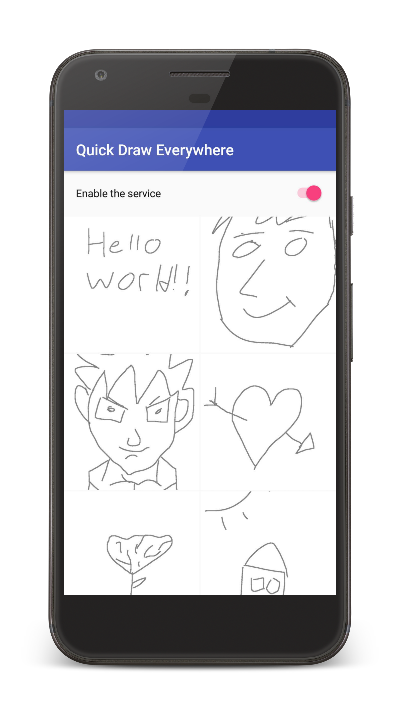
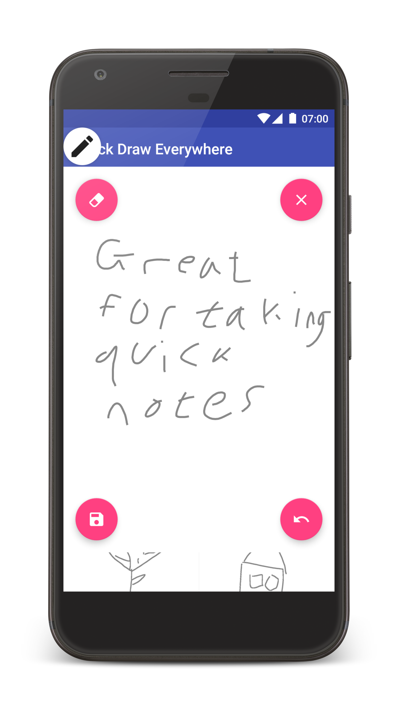

# Quick-Draw-Everywhere

Quickly draw anywhere on your screen

| Gallery screen | Drawing floating screen |
|:-:|:-:|
|  |  |

## Licensing

As of the 2026-09-09 Coding Pilot preparation commit, material owned by Tomer
Rosenfeld is additionally offered under the MIT terms in [LICENSE](LICENSE).
Earlier commits retain their historically recorded GPL-3.0 grant. Bundled and
external third-party works are not relicensed; see
[THIRD_PARTY_NOTICES.md](THIRD_PARTY_NOTICES.md) and their preserved notices.
